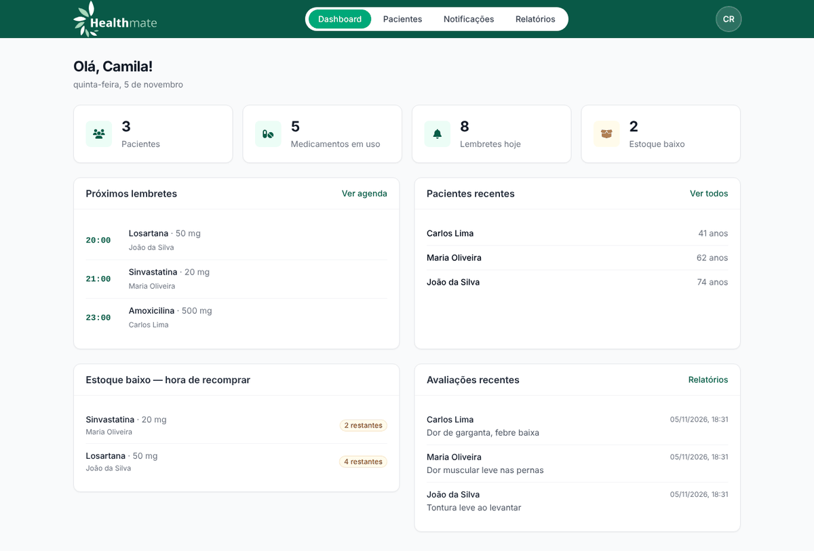
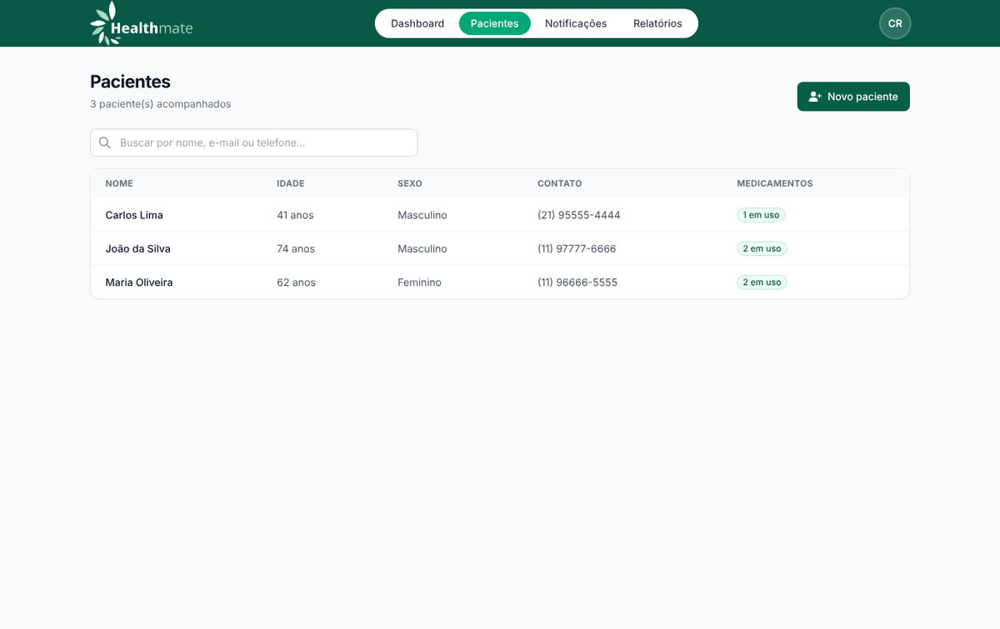
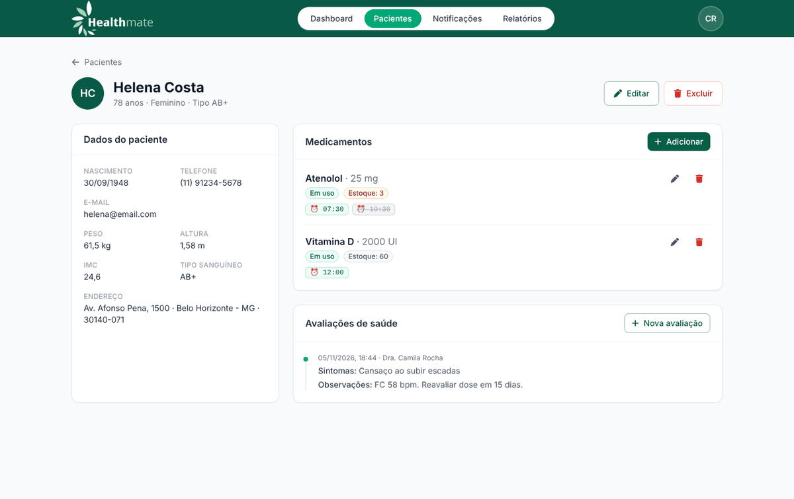
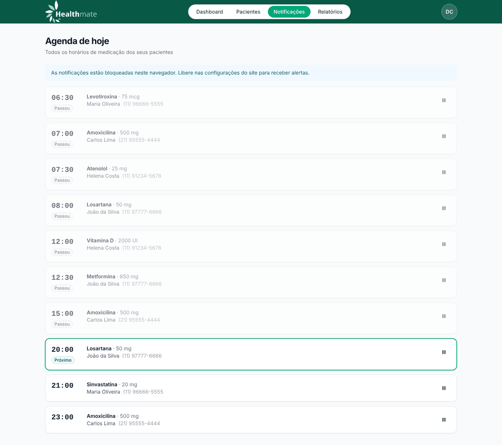
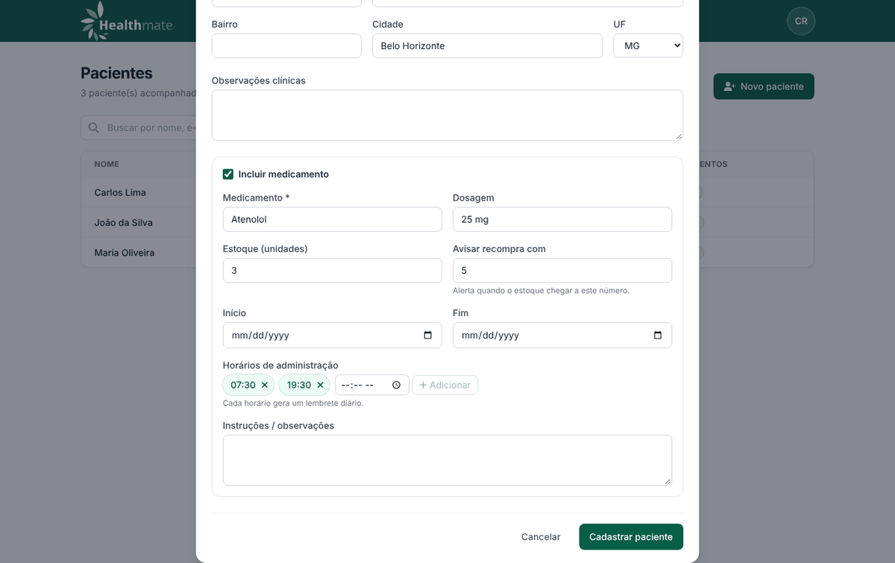
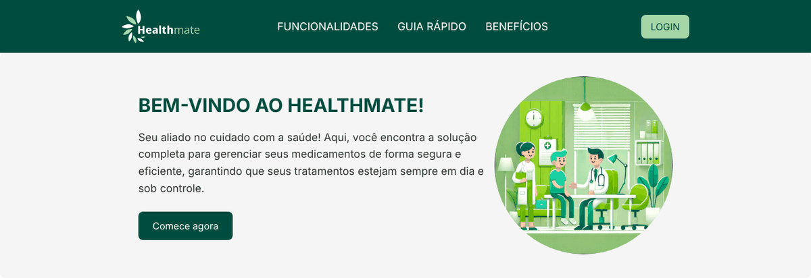
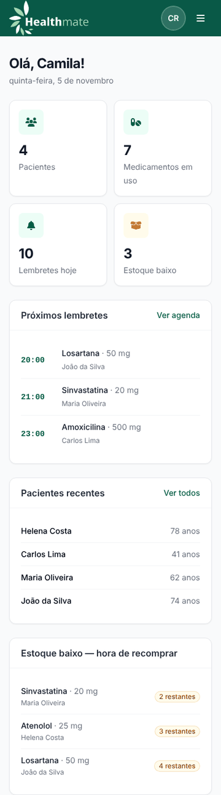
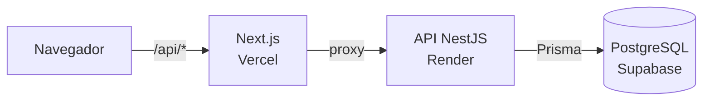

<div align="center">

# HealthMate

**Gestão de medicamentos e lembretes para profissionais de saúde**




</div>

---

## Sobre

Esquecer uma dose, tomar o remédio na hora errada ou deixar o estoque acabar são problemas
comuns no tratamento de doenças crônicas, e quem cuida de vários pacientes ao mesmo tempo
tem dificuldade de acompanhar tudo.

O **HealthMate** é uma plataforma web para **profissionais de saúde autônomos** (enfermeiros,
cuidadores, farmacêuticos e médicos). Ela reúne num só lugar os pacientes, os medicamentos de
cada um, os horários de administração e o histórico de avaliações. Cada profissional enxerga
apenas os próprios pacientes.

Este repositório é o **front-end**. A API está em
**[healthmate-api](https://github.com/megusta01/healthmate-api)**.

## Funcionalidades

- **Cadastro de pacientes:** dados pessoais, clínicos (peso, altura, IMC, tipo sanguíneo) e endereço, com o primeiro medicamento no mesmo formulário.
- **Medicamentos:** dosagem, período de uso, situação (em uso, concluído, suspenso), estoque e vários horários diários.
- **Agenda do dia:** todos os horários de medicação de todos os pacientes, destacando o próximo.
- **Alertas no navegador:** notificação no horário de cada dose enquanto o app está aberto.
- **Alerta de recompra:** o dashboard avisa quando o estoque de um medicamento está acabando.
- **Avaliações e relatórios:** sintomas, efeitos colaterais e conduta registrados em linha do tempo, com busca e impressão/PDF.
- **Contas seguras:** login com e-mail e senha ou com Google, sessão em cookies httpOnly e renovação automática.
- **Responsivo:** funciona no computador e no celular.

## Telas

| Pacientes | Ficha do paciente |
|---|---|
|  |  |
| **Agenda do dia** | **Novo paciente** |
|  |  |

<div align="center">

&nbsp;&nbsp;

</div>

## Tecnologias

| Camada | Tecnologias |
|---|---|
| **Front-end** | [Next.js 15](https://nextjs.org/) (Pages Router), [React 19](https://react.dev/), [TypeScript](https://www.typescriptlang.org/), [Tailwind CSS](https://tailwindcss.com/), CSS Modules, [Axios](https://axios-http.com/), [Font Awesome](https://fontawesome.com/), [Google Identity Services](https://developers.google.com/identity/gsi/web) |
| **API** | [NestJS 11](https://nestjs.com/), [Prisma 7](https://www.prisma.io/), JWT, Swagger |
| **Banco de dados** | [PostgreSQL](https://www.postgresql.org/) no [Supabase](https://supabase.com/) |
| **Hospedagem** | [Vercel](https://vercel.com/) (front) e [Render](https://render.com/) (API) |

## Arquitetura



O navegador conversa apenas com o próprio front. O Next.js repassa as chamadas `/api/*` para a
API. Com isso, os cookies de sessão são do mesmo domínio do site: funcionam em qualquer
navegador, sem configuração de CORS e sem guardar token no `localStorage`.

## Como rodar

**Pré-requisitos:** Node.js **20.19+** (recomendado 24 LTS) e a
[API](https://github.com/megusta01/healthmate-api) rodando (local ou publicada).

```bash
git clone https://github.com/megusta01/healthmate.git
cd healthmate
cp .env.example .env.local   # no Windows: copy .env.example .env.local
npm install
npm run dev                  # http://localhost:3000
```

### Variáveis de ambiente

| Variável | Descrição |
|---|---|
| `API_URL` | URL da API, sem `/api` no final. Ex.: `http://localhost:3333` |
| `NEXT_PUBLIC_GOOGLE_CLIENT_ID` | *(opcional)* Habilita o botão "Continuar com Google" |

O `API_URL` é lido quando o Next inicia (e no build da Vercel). Depois de alterá-lo, reinicie o `npm run dev` ou faça um novo deploy.

### Scripts

| Script | O que faz |
|---|---|
| `npm run dev` | Servidor de desenvolvimento |
| `npm run build` | Build de produção |
| `npm run start` | Roda o build de produção |
| `npm run lint` | ESLint |
| `npm run typecheck` | Verificação de tipos |

## Estrutura

```
src/
├── pages/              # rotas: login, cadastro, dashboard, pacientes/[id], notificacoes, relatorios, perfil
├── components/
│   ├── forms/          # PatientForm, MedicamentForm, TimesInput
│   ├── home/           # seções da landing page
│   ├── AppLayout.tsx   # casca das telas internas (exige login)
│   ├── Header.tsx
│   ├── Modal.tsx
│   └── ui.tsx          # botões, campos, cards, badges
├── contexts/           # AuthContext (sessão) e ToastContext
├── hooks/              # useApi e useReminderAlerts
├── lib/                # cliente HTTP com refresh automático e formatadores
├── types/              # tipos das respostas da API
└── middleware.ts       # redireciona rotas antigas
```

## Deploy

1. Importe o repositório na [Vercel](https://vercel.com/new).
2. Em **Environment Variables**, defina `API_URL` com a URL pública da API.
3. Clique em **Deploy**.

Na API, ajuste `FRONTEND_URL` para o domínio gerado pela Vercel.

## Desenvolvedor

<table>
  <tr>
    <td align="center">
      <a href="https://github.com/megusta01">
        <br />
        <b>Gustavo Figueredo</b>
      </a><br />
      Desenvolvedor Full Stack<br />
      <a href="mailto:gustavofigueredo86@gmail.com">E-mail</a> ·
      <a href="https://github.com/megusta01">GitHub</a>
    </td>
  </tr>
</table>
